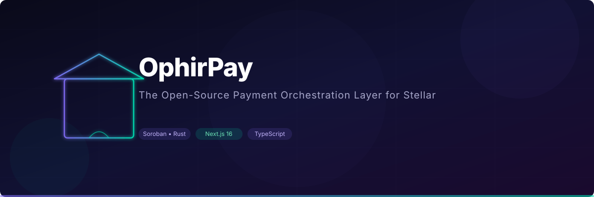

<div align="center">
  

  <h1>🏦 OphirPay</h1>

  <h3><em>Stellar向けオープンソース決済オーケストレーションレイヤー</em></h3>

  <p>
    ブロックチェーン決済を送信、バッチ処理、スケジュール、トラッキング — 全てを強力なダッシュボードから。
    <strong>Stellar</strong> と <strong>Soroban</strong> 上にネイティブ構築。個人、スタートアップ、
    NPO、DAO のためにスピード、透明性、低手数料を求める方々向け。
  </p>

  <br />

  <p>
    <strong>🌐 言語:</strong>
    <a href="README.md">🇬🇧 English</a> ·
    <a href="README.es.md">🇪🇸 Español</a> ·
    <a href="README.fr.md">🇫🇷 Français</a> ·
    <strong>🇯🇵 日本語</strong>
  </p>

  <p>
    <a href="https://github.com/OphirPay/OphirPay/actions/workflows/ci.yml">
      
    </a>
    <a href="#-テストと品質">
      
    </a>
    <a href="#-テストと品質">
      
    </a>
    <a href="docs/AUDIT.md">
      
    </a>
    <a href="e2e/">
      
    </a>
    <a href="docs/GAS.md">
      
    </a>
    <a href="https://ophirpay.vercel.app">
      
    </a>
    <a href="https://www.loom.com/share/0d59c50285c04224a4857720b3640018">
      
    </a>
    <a href="https://stellar.expert/explorer/testnet/contract/CCQGGUJRRVXMHNEX2RYPODGJE2YRMYY4Y7A3KTJH3QP2LWZLTCOPRPET">
      
    </a>
    <a href="docs/deployment-mainnet.md">
      
    </a>
    <a href="LICENSE">
      
    </a>
    <a href="https://github.com/OphirPay/OphirPay/releases">
      
    </a>
  </p>
</div>

<!-- readme-sync: 1c81e7a28c90a66bc2b0fbf56d7bbeec39d243fe -->

---

## 📑 目次

- [✨ なぜOphirPay？](#-なぜophirpay)
- [🚀 ライブデモ](#-ライブデモ)
- [🧭 システムアーキテクチャ](#-システムアーキテクチャ)
- [⚡ クイックスタート](#-クイックスタート)
- [🛠 ローカル開発ガイド](docs/LOCAL_DEV.md)
- [🐳 ローカルStellar Standalone（Docker）](docs/LOCAL_DEV.md#13-local-stellar-quickstart-standalone-container-offline-testing--development)
- [🔐 ウォレット統合](#-ウォレット統合)
- [📡 リアルタイムイベント](#-リアルタイムイベント)
- [🧪 スマートコントラクト](#-スマートコントラクト)
- [🌟 Stellar入門](docs/STELLAR_101.md)
- [🔑 FriendbotとテストネットのフォーセットFAQ](docs/STELLAR_101.md#friendbot-faq--faucets)
- [📊 テストと品質](#-テストと品質)
- [🛠 技術スタック](#-技術スタック)
- [📊 データベーススキーマ](docs/SCHEMA.md)
- [🚀 デプロイガイド](docs/DEPLOYMENT.md)
- [📡 SSEイベントストリーム](docs/SSE.md)
- [⚡ WebSocketイベントサーバー](docs/WEBSOCKET.md)
- [🧾 コントラクトエラーカタログ](docs/ERRORS.md)
- [🧪 コントラクトテストガイド](docs/TESTING.md)
- [🚨 緊急時運用ランブック](docs/EMERGENCY.md)
- [🔒 セキュリティポリシー](SECURITY.md)
- [🤝 コントリビュート](#-コントリビュート)
- [📖 Stellar用語集](GLOSSARY.md)
- [📄 ライセンスとクレジット](#-ライセンスとクレジット)

---

## ✨ なぜOphirPay？

ほとんどのブロックチェーン決済ツールは、開発者向けSDKか複雑なエンタープライズダッシュボードです。**OphirPayはそのギャップを埋めます** — DAOトレジャリーにも十分な機能を持ち、初のクリプト決済を送信するフリーランサーにも直感的に使える、本格級のオープンソース決済プラットフォーム。

| 機能                                                                                          | OphirPay | 一般的なdApp |
| --------------------------------------------------------------------------------------------- | -------- | ------------ |
| 個別決済                                                                                      | ✅       | ✅           |
| **エスクロー**（ダッシュボードでの作成・請求・オーナー／仲裁者によるリリース）                | ✅       | ❌           |
| **決済ストリーム**（ベスティング、受取人による請求、作成者によるキャンセル）                  | ✅       | ❌           |
| **バッチ決済**（1トランザクションで複数受取人）                                               | ✅       | ❌           |
| **定期決済スケジュール**                                                                      | ✅       | ❌           |
| **決済リクエスト**（共有可能な請求書、期限、期限切れ通知、メールリマインダー）                | ✅       | ❌           |
| **アドレス帳CSVインポート／エクスポート**（検証・重複検出付き）                               | ✅       | ❌           |
| **SEP-7モバイルウォレットハンドオフ**（標準StellarペイメントURI）                             | ✅       | ❌           |
| **XLMの法定通貨価格表示**（ソースのフォールバック、上限付きキャッシュ、明示的な取得不可状態） | ✅       | ❌           |
| **リアルタイムイベントストリーミング**（SSE）                                                 | ✅       | ❌           |
| **Webhook配信**（HMAC署名、リトライ）                                                         | ✅       | ❌           |
| **クロスコントラクト通信**                                                                    | ✅       | ❌           |
| **マルチウォレット対応**（Freighter、xBull、Rabet、Albedo、Lobstr、Ledgerの6種）              | ✅       | ❌           |
| **マルチアセット対応**（USDC、カスタムトークン）                                              | ✅       | ❌           |
| **パス決済**（アセット間送金、レートプレビュー、スリッページ保護）                            | ✅       | ❌           |
| **PWA**（インストールプロンプト、オフラインフォールバックページ）                             | ✅       | ❌           |
| **発見しやすいキーボードショートカットとテーブルナビゲーション**                              | ✅       | ❌           |
| **分類されたエラーハンドリング**（3タイプ、約300のコントラクトエラー）                        | ✅       | ❌           |
| **ダッシュボードのナビゲーションを保つページエラーバウンダリ**                                | ✅       | ❌           |
| **PostgreSQL + SQLite**（プロバイダー切り替え）                                               | ✅       | ⚠️           |
| **マルチシグ承認**（N-of-M署名者）                                                            | ✅       | ❌           |
| **支出制限 + エスカレーション階層**                                                           | ✅       | ❌           |
| **RBAC**（管理者／オペレーター／監査者ロール）                                                | ✅       | ❌           |
| **オンチェーン監査ログ**（不変の追跡）                                                        | ✅       | ❌           |
| **手数料設定**（操作ごとのbps）                                                               | ✅       | ❌           |
| **タイムロック管理アクション**（24時間遅延）                                                  | ✅       | ❌           |
| **DAOガバナンス**（提案→投票→実行）                                                           | ✅       | ❌           |
| **構造化リファンド**（6つの理由コード、分析）                                                 | ✅       | ❌           |
| **オンチェーン通知フック**（購読者インデックス付き）                                          | ✅       | ❌           |
| **クロスコントラクトオーケストレーション**（アトミックなpause_all）                           | ✅       | ❌           |
| **ポリシーバージョニング**（不変の設定履歴）                                                  | ✅       | ❌           |
| **2段階の管理者ローテーション**（24時間タイムロック）                                         | ✅       | ❌           |
| **アプリ内通知センター**（ベル、未読数、SSEのライブ更新、セッション永続化）                   | ✅       | ❌           |

> 上記のすべての機能にはダッシュボードUIページがあります。詳細は[ロードマップ](README.md#-roadmap)を参照。
>
> 📄 **バッチ決済CSVインポート** — 正確なCSV形式、検証ルール、エラーメッセージは[docs/CSV_FORMAT.md](docs/CSV_FORMAT.md)を参照。
>
> 📇 **アドレス帳CSVインポート／エクスポート** — `label,address,memo`列で連絡先をインポート。無効な行は報告され、既存エントリはアドレスでマージされます。

| **充実したCI/CDと3,031件のテスト（アプリ2,867 + コントラクト67 + E2E 97）** | ✅  | ⚠️  |
| --------------------------------------------------------------------------- | --- | --- |

---

## 🚀 ライブデモ

<div align="center">

### 🔗 **[ophirpay.vercel.app](https://ophirpay.vercel.app)**

_Vercelにデプロイ — すべてのプッシュで`main`から自動ビルド。PostgreSQL（Neon）、Sorobanテストネットコントラクト、ライブウォレットフローが接続済み。_

### 🎥 ピッチ動画（3分）

<video src="https://raw.githubusercontent.com/OphirPay/OphirPay/main/public/demo.mp4" controls width="720" poster="https://raw.githubusercontent.com/OphirPay/OphirPay/main/public/ophirpay-banner.svg" style="max-width:100%;border-radius:12px;box-shadow:0 4px 24px rgba(0,0,0,0.15)">
  お使いのブラウザは埋め込み動画に対応していません。
  <a href="https://ophirpay.vercel.app/demo.mp4">Vercelで視聴 →</a>
</video>

_11シーン：問題 → ライブダッシュボード → Vercelデプロイ → Sorobanコントラクト → 決済送信 → リアルタイムイベント → GitHub README → CIパイプライン → マルチシグセキュリティ → オープンソース → クレジット_

**▶️ [Loomで視聴](https://www.loom.com/share/0d59c50285c04224a4857720b3640018)** · [Vercelで視聴](https://ophirpay.vercel.app/demo.mp4)

ローカルでのシード付きウォークスルー手順と`NEXT_PUBLIC_DEMO_MODE`の正確な範囲は[docs/DEMO_MODE.md](docs/DEMO_MODE.md)を参照。

</div>

---

## 🧭 システムアーキテクチャ

```
┌─────────────────────────────────────────────────────────────┐
│                   OPHIRPAYプラットフォーム                     │
├─────────────────────────────────────────────────────────────┤
│                                                             │
│  ┌──────────┐   ┌──────────┐   ┌──────────┐   ┌─────────┐ │
│  │トレジャリー│  │  決済    │   │ バッチ   │   │コントラクト│ │
│  │ ダッシュボード│ │  送信   │   │ (マルチ) │   │ ページ  │ │
│  └────┬─────┘   └────┬─────┘   └────┬─────┘   └────┬────┘ │
│       │              │              │              │       │
│  ┌────┴──────────────┴──────────────┴──────────────┴────┐  │
│  │              useWallet() / WalletProvider             │  │
│  │        セッション永続化 · 残高 · 認証                    │  │
│  └────────────────────────┬─────────────────────────────┘  │
│                           │                                │
│  ┌────────────────────────┼─────────────────────────────┐  │
│  │              Stellar SDK レイヤー                      │  │
│  │  ┌──────────┐  ┌──────────┐  ┌────────────────────┐  │  │
│  │  │ Horizon  │  │ Soroban  │  │  TXビルダー/       │  │  │
│  │  │ (残高)   │  │   RPC    │  │  サイナー          │  │  │
│  │  └──────────┘  └──────────┘  └────────────────────┘  │  │
│  └────────────────────────┬─────────────────────────────┘  │
│                           │                                │
│  ┌────────────────────────┴─────────────────────────────┐  │
│  │           Sorobanスマートコントラクト                    │  │
│  │                                                       │  │
│  │  ┌──────────────────┐ ネイティブイベント ┌─────────┐  │  │
│  │  │ OphirPayContract │ + クロスコントラクト│ エミッター│  │  │
│  │  │  · record_payment│   pause/unpause   │コントラクト│  │  │
│  │  │  · propose_pay.  │   オーケストレーション│· events │  │  │
│  │  │  · grant_role    │                   └────┬────┘  │  │
│  │  │  · set_fee_config│                        │       │  │
│  │  │  · 60以上の関数  │                        │       │  │
│  │  └──────────────────┘                        │       │  │
│  └────────────────────────────────────────────────┼──────┘  │
│                                                   │         │
│  ┌────────────────────────────────────────────────┴──────┐  │
│  │      SSEイベントストリーム (GET /api/events)            │  │
│  │      エミッターコントラクトをポーリング → UIにストリーム   │  │
│  └───────────────────────────────────────────────────────┘  │
│                                                             │
│  ┌──────────────────────────────────────────────────────┐   │
│  │              データレイヤー                             │   │
│  │  ┌──────────┐  ┌──────────┐  ┌──────────────────┐   │   │
│  │  │  Prisma  │  │PostgreSQL│  │  APIルート        │   │   │
│  │  │  (ORM)   │  │ (Neon)   │  │  /api/batches    │   │   │
│  │  │          │  │SQLite dev│  │  /api/health     │   │   │
│  │  └──────────┘  └──────────┘  └──────────────────┘   │   │
│  └──────────────────────────────────────────────────────┘   │
└─────────────────────────────────────────────────────────────┘
```

---

## ⚡ クイックスタート

> **Stellarが初めてですか？** アカウント、トランザクション、XLM、SorobanをWeb開発者向けに解説した[Stellar 101](docs/STELLAR_101.md)を先に読んでください。Friendbotのレート制限対処法は[フォーセットFAQ](docs/STELLAR_101.md#friendbot-faq--faucets)にまとまっています。
>
> 🐳 **オフライン開発：** テストネットのFriendbotレート制限を避けてスマートコントラクトを開発・テストしたい場合は、Soroban RPCとFriendbot（ポート8000）を内蔵したローカルコンテナを起動する[Stellar Quickstart Standaloneガイド](docs/LOCAL_DEV.md#13-local-stellar-quickstart-standalone-container-offline-testing--development)を参照してください。

### 前提条件

| ツール                                    | バージョン | 用途                                                                                     |
| ----------------------------------------- | ---------- | ---------------------------------------------------------------------------------------- |
| [Node.js](https://nodejs.org)             | 18+        | ランタイム                                                                               |
| [Freighter Wallet](https://freighter.app) | 最新       | Stellar用ブラウザ拡張                                                                    |
| [Git](https://git-scm.com)                | 任意       | リポジトリのクローン                                                                     |
| 資金済みテストネットアカウント            | —          | [Friendbot](https://laboratory.stellar.org/#account-creator?network=test)で無料XLMを取得 |

### 5分でセットアップ

```bash
# 1. クローンして移動
git clone https://github.com/OphirPay/OphirPay.git && cd OphirPay

# 2. すべてインストール
npm install

# 3. データベース初期化
npx prisma db push && npx prisma generate

# 4. 環境変数テンプレートをコピー
cp .env.example .env

# 5. 起動！
npm run dev
```

**[http://localhost:3000](http://localhost:3000)** を開き、Freighterウォレットを接続すれば、テストネットXLMの送信準備完了です。

デモ前のスモークテストで動作確認できます：

```bash
bash scripts/demo-test.sh
```

<details>
<summary><strong>📋 環境変数リファレンス</strong></summary>

```env
# データベース
DATABASE_URL="file:./dev.db"

# Stellarネットワーク（メインネットは TESTNET → PUBLIC に変更！）
NEXT_PUBLIC_STELLAR_NETWORK="TESTNET"
NEXT_PUBLIC_STELLAR_RPC_URL="https://soroban-testnet.stellar.org:443"
NEXT_PUBLIC_STELLAR_HORIZON_URL="https://horizon-testnet.stellar.org"
STELLAR_NETWORK_PASSPHRASE="Test SDF Network ; September 2015"

# Sorobanコントラクト（テストネットにデプロイ済み — 動作確認済み）
NEXT_PUBLIC_CONTRACT_ID="CCQGGUJRRVXMHNEX2RYPODGJE2YRMYY4Y7A3KTJH3QP2LWZLTCOPRPET"
NEXT_PUBLIC_EMITTER_CONTRACT_ID="CDAVU2XJ7C2Y52GRJZKRG3HDI7AJ2K2FHAFH5FPDTSUQAV7XNBQNNVAN"

# アプリ
NEXT_PUBLIC_APP_URL="http://localhost:3000"
```

> ⚡ **メインネット移行**: `NEXT_PUBLIC_STELLAR_NETWORK="PUBLIC"`に変更し、RPC/HorizonのURLを更新するだけです。

</details>

---

## 🔐 ウォレット統合

OphirPayは、統合コネクターアブストラクションを通じて複数のStellarウォレットをサポートしています。`MultiWalletProvider`コンテキストがアプリケーション全体をラップし、以下を提供します：

| 機能                   | 実装                                                                                |
| ---------------------- | ----------------------------------------------------------------------------------- |
| **マルチウォレット**   | Freighter、Albedo、xBull、Rabet、Lobstr、LedgerハードウェアウォレットのコネクターIF |
| **接続**               | ウォレットセレクターモーダル → `connector.connect()`                                |
| **切断**               | 完全な状態リセット + コネクター固有のクリーンアップ                                 |
| **セッション永続化**   | ページ読み込み時に既存の接続を自動検出                                              |
| **未インストール検出** | 「Not found」バッジ + 実行可能なエラーメッセージで優雅に処理                        |
| **接続拒否**           | 捕捉してインラインエラーとして表示                                                  |
| **残高更新**           | 手動更新ボタン + 送金後の自動更新                                                   |
| **ローディング状態**   | `balanceLoading`フラグ → スケルトンシマー                                           |
| **ネットワークバッジ** | ステータスドット付きでTESTNET/PUBLICをライブ表示                                    |

**サポートされているウォレット：**

| ウォレット | タイプ                    | ステータス      |
| ---------- | ------------------------- | --------------- |
| Freighter  | ブラウザ拡張機能          | ✅ サポート済み |
| xBull      | ブラウザ拡張機能          | ✅ サポート済み |
| Rabet      | ブラウザ拡張機能          | ✅ サポート済み |
| Albedo     | Webベース（拡張機能不要） | ✅ サポート済み |
| Lobstr     | Webベース（SEP-7）        | ✅ サポート済み |
| Ledger     | ハードウェア（WebUSB）    | ✅ サポート済み |

> **Ledgerの要件：** Stellarアプリを開いた状態でLedgerデバイスをUSB接続してください。ブラウザ署名はWebUSBを使用し、HTTPSまたは`localhost`上のChromium系ブラウザ（Chrome、Edge、Brave、Opera）で利用できます。トランザクションは標準の`44'/148'/0'`アカウントパスでデバイス上署名されます。詳細は[Ledgerの状態](docs/STELLAR_101.md#wallet-connectors--ledger-status)を参照。

```tsx
// アプリのどこでもウォレットを利用
const { wallet, connect, disconnect, fetchBalance } = useWallet();

// wallet.connected      → boolean
// wallet.publicKey      → "GABCD..."
// wallet.balance        → "12500.50"
// wallet.network        → "TESTNET"
// wallet.activeWalletId → "freighter" | "albedo" | "xbull"

// 特定のウォレットに接続
connect("albedo"); // "freighter"、"xbull"も同様
```

---

## 📡 リアルタイムイベント

OphirPayは、**WebSocketサーバー**（`ws(s)://<host>:8787/api/events`、自動keep-alive ping付きの低遅延プッシュ）と**Server-Sent Events（SSE）**（`GET /api/events`、透過的なHTTPフォールバック）のデュアルトランスポートで**ブロックチェーンのライブイベント**を配信します。どちらも、デプロイされた`PaymentEventEmitter` Sorobanコントラクトをデータソースとする同一のイベントペイロードスキーマを共有します。

```
ブラウザ ←── WS:  ws(s)://<host>:8787/api/events ──ポーリング──→ PaymentEventEmitter (Soroban)
        ←── SSE: GET /api/events (フォールバック)              ↓
                                                         get_event_count()
                                                         get_event(id)
```

**発行されるイベント：**

| イベント          | トリガー                                    |
| ----------------- | ------------------------------------------- |
| `connected`       | ストリーム確立                              |
| `heartbeat`       | 15秒ごと（SSE）／ 30秒ごと（WS keep-alive） |
| `payment:created` | オンチェーンで新しい決済イベントを検出      |

アプリの**`/events`**で、接続状態インジケーター、イベントタイプバッジ、タイムスタンプ、自動スクロール付きのライブフィードを確認できます。

> ⚡ **WebSocketサーバーとプロトコル：** スタンドアロンのRFC 6455実装、メッセージスキーマ、再接続とフォールバックのライフサイクル、ポート設定、デプロイ構成は[docs/WEBSOCKET.md](docs/WEBSOCKET.md)を参照。
>
> 📡 **クライアント統合（SSE）：** ストリーム仕様、ペイロードスキーマ、再接続セマンティクス、負荷テストガイドは[docs/SSE.md](docs/SSE.md)を参照。

---

## 🧪 スマートコントラクト

OphirPayは**2つのSorobanコントラクト**をデプロイしています。メインの`OphirPayContract`はすべての決済ロジックを処理し、ネイティブのオンチェーンイベントを発行します。一方、`PaymentEventEmitter`はアプリのSSEストリームがクエリする決済イベントレコードを保存します — 決済ロジックとイベント発行を分離し、よりクリーンなアーキテクチャと独立したクエリ性を実現しています。両コントラクトはクロスコントラクトオーケストレーションにも対応しており、`emergency_pause_all` / `emergency_unpause_all`がサーキットブレーカーをエミッターへアトミックに伝播します。

> 📖 **詳細：** OphirPayが`env.invoke_contract`でエミッターを呼び出す仕組み、責務を分離する理由、新しいコントラクトへパターンを拡張する方法は[docs/CONTRACT_ARCHITECTURE.md](docs/CONTRACT_ARCHITECTURE.md)を参照。
>
> 🚨 **緊急時：** 一時停止、スコープ停止、タイムロックアクション、アップグレードのロールバック、オーナー移譲の手順は[緊急時運用ランブック](docs/EMERGENCY.md)にCLIコマンド付きで記載されています。

### 🔗 コントラクト間フロー

```
OphirPayContract.record_payment(payer, payee, amount, asset, tx_hash, metadata)
  │
  ├─ 1. 同一のpayer + tx_hashでの再試行には既存の決済IDを返す
  ├─ 2. それ以外は決済カウンターを進めて決済を保存
  └─ 3. 新しいレコードに対してネイティブSorobanイベントを1回発行
        env.events().publish(("payment", payer, payee), amount)

ブラウザ ←── SSEストリーム (GET /api/events) ──ポーリング──→ PaymentEventEmitter
        │                                                     │
        └─ payment:createdイベント                             └─ get_event_count() / get_event(id)

緊急オーケストレーション（クロスコントラクト）:
OphirPayContract.emergency_pause_all() / emergency_unpause_all()
  └─ env.invoke_contract(emitter, "pause"/"unpause") → PaymentEventEmitter
```

### 📦 メインコントラクト — `OphirPayContract`

| 項目                 | 値                                                                                                                                |
| -------------------- | --------------------------------------------------------------------------------------------------------------------------------- |
| **コントラクトID**   | `CCQGGUJRRVXMHNEX2RYPODGJE2YRMYY4Y7A3KTJH3QP2LWZLTCOPRPET`                                                                        |
| **ネットワーク**     | Stellarテストネット（Soroban RPCで動作確認済み）                                                                                  |
| **WASMハッシュ**     | デプロイ済み: `2114b304...` · 強化版 `31d9aa78...` を提案中（24時間タイムロック、セキュリティ修正）                               |
| **状態**             | 初期化済み、オンチェーンで決済を記録中                                                                                            |
| **エクスプローラー** | [Stellar Expertで表示](https://stellar.expert/explorer/testnet/contract/CCQGGUJRRVXMHNEX2RYPODGJE2YRMYY4Y7A3KTJH3QP2LWZLTCOPRPET) |
| **メインネットID**   | _未デプロイ_ — [docs/deployment-mainnet.md](docs/deployment-mainnet.md)を参照                                                     |

| 関数                                                             | アクセス     | 説明                                                                              |
| ---------------------------------------------------------------- | ------------ | --------------------------------------------------------------------------------- |
| `init(owner)`                                                    | 管理者       | コントラクトをオーナーアドレスで初期化                                            |
| `record_payment(payer, payee, amount, asset, tx_hash, metadata)` | 支払者認証   | 決済を保存 + ネイティブSorobanイベントを発行、payer + `tx_hash`で再試行を重複排除 |
| `cancel_payment(id)`                                             | 公開         | 記録済み決済をキャンセル                                                          |
| `propose_payment(...)`                                           | マルチシグ   | マルチシグ決済リクエストを提案                                                    |
| `approve_payment(id)`                                            | マルチシグ   | マルチシグ決済リクエストを承認                                                    |
| `execute_approved_payment(id)`                                   | マルチシグ   | 承認済み決済を実行                                                                |
| `set_multisig_config(...)`                                       | 管理者       | N-of-Mしきい値を設定（バージョン管理付き）                                        |
| `set_fee_config(...)`                                            | 管理者       | 操作ごとの手数料（bps）を設定                                                     |
| `set_fee_collector(...)`                                         | 管理者       | 手数料受取人を指定                                                                |
| `propose_timelocked_action(...)`                                 | 管理者       | 必須遅延付きの管理者アクションを提案（オフチェーン記録用）                        |
| `execute_timelocked_action(id)`                                  | 公開         | 遅延経過後に実行                                                                  |
| `cancel_timelocked_action(id)`                                   | 管理者       | 保留中のアクションをキャンセル                                                    |
| `configure_governance(...)`                                      | 管理者       | ガバナンスパラメータを設定                                                        |
| `create_proposal(...)`                                           | ガバナンス   | DAOガバナンス提案を作成（デポジット必須）                                         |
| `vote_on_proposal(id, support)`                                  | ガバナンス   | YES/NO投票（1アドレス=1票）                                                       |
| `execute_proposal(id)`                                           | ガバナンス   | 可決された提案を実行                                                              |
| `set_spending_limit(...)`                                        | 管理者       | ユーザーごとの支出制限を設定                                                      |
| `check_spending(user, amount)`                                   | 読み取り     | 制限とエスカレーション階層を確認                                                  |
| `atomic_spend(...)`                                              | オペレーター | 制限を適用して支出                                                                |
| `grant_role(grantee, role)`                                      | 管理者       | RBACロールを付与（管理者／オペレーター／監査者）                                  |
| `revoke_role(grantee)`                                           | 管理者       | ロールを剥奪                                                                      |
| `set_emitter(emitter)`                                           | 管理者       | イベントエミッターコントラクトを指定                                              |
| `emergency_pause_all()`                                          | 管理者       | アトミックなクロスコントラクト停止                                                |
| `emergency_unpause_all()`                                        | 管理者       | 運用を再開                                                                        |
| `emergency_withdraw(...)`                                        | 管理者       | `残高 − LOCKED_BALANCE`を上限に引き出し                                           |
| `propose_upgrade(...)` / `execute_upgrade()`                     | 管理者       | 24時間タイムロック付きWASMアップグレード                                          |
| `transfer_ownership(...)` / `accept_ownership()`                 | 管理者       | 2段階のオーナー移譲（24時間タイムロック）                                         |
| `get_payment(id)` / `get_payments_range(...)`                    | 読み取り     | 決済を取得                                                                        |
| `get_payment_count()`                                            | 読み取り     | 記録済み決済の総数                                                                |
| `get_stats()`                                                    | 読み取り     | すべてのコントラクトカウンター（ガス最適化済み）                                  |
| `get_fee_config()` / `get_fee_config_history()`                  | 読み取り     | 手数料設定 + 不変の履歴                                                           |
| `get_audit_log_count()` / `get_audit_entry(id)`                  | 読み取り     | 不変のオンチェーン監査証跡                                                        |

### 📡 エミッターコントラクト — `PaymentEventEmitter`

| 項目                 | 値                                                                                                                                |
| -------------------- | --------------------------------------------------------------------------------------------------------------------------------- |
| **コントラクトID**   | `CDAVU2XJ7C2Y52GRJZKRG3HDI7AJ2K2FHAFH5FPDTSUQAV7XNBQNNVAN`                                                                        |
| **WASMハッシュ**     | デプロイ済み: `6ff35169...` · 許可リスト `6d02394b...` を提案中（24時間タイムロック）                                             |
| **目的**             | 決済イベントレコードを保存（SSEストリームがクエリ）+ クロスコントラクトのpause/unpauseを受信                                      |
| **エクスプローラー** | [Stellar Expertで表示](https://stellar.expert/explorer/testnet/contract/CDAVU2XJ7C2Y52GRJZKRG3HDI7AJ2K2FHAFH5FPDTSUQAV7XNBQNNVAN) |
| **メインネットID**   | _未デプロイ_ — [docs/deployment-mainnet.md](docs/deployment-mainnet.md)を参照                                                     |

| 関数                                                   | アクセス | 説明                                                           |
| ------------------------------------------------------ | -------- | -------------------------------------------------------------- |
| `init(owner)`                                          | 管理者   | エミッターを初期化                                             |
| `emit_payment(emitter, payer, payee, amount, tx_hash)` | 公開     | PaymentEventレコードを保存                                     |
| `get_event(event_id)`                                  | 読み取り | IDでイベントを取得                                             |
| `get_event_count()`                                    | 読み取り | 発行済みイベントの総数                                         |
| `get_owner()`                                          | 読み取り | エミッターのオーナーを取得                                     |
| `pause()` / `unpause()`                                | 管理者   | サーキットブレーカー                                           |
| `set_allowed_source(source)`                           | 管理者   | イベント発行を許可するオーケストレーターを登録（MEDIUM-3修正） |
| `get_allowed_source()`                                 | 読み取り | 許可済みソースを取得（設定時）                                 |
| `propose_upgrade(...)` / `execute_upgrade()`           | 管理者   | タイムロック付きアップグレード                                 |

### 🔨 ビルドとデプロイ

<details>
<summary><strong>ソースからビルド</strong></summary>

```bash
# 両コントラクトをWASMにビルド
cd contracts/ophirpay && cargo build --target wasm32v1-none --release
cd contracts/emitter && cargo build --target wasm32v1-none --release
```

</details>

<details>
<summary><strong>手動デプロイ（4ステップ）</strong></summary>

```bash
# 1. エミッターをデプロイ
stellar contract deploy \
  --wasm contracts/emitter/target/wasm32v1-none/release/ophirpay_emitter.wasm \
  --source-account <SECRET_KEY> \
  --rpc-url "https://soroban-testnet.stellar.org:443" \
  --network-passphrase "Test SDF Network ; September 2015"

# 2. エミッターを初期化
stellar contract invoke --id <EMITTER_ID> --source-account <SECRET_KEY> \
  --rpc-url "https://soroban-testnet.stellar.org:443" \
  --network-passphrase "Test SDF Network ; September 2015" \
  -- init --owner <OWNER_PUBLIC_KEY>

# 3. メインコントラクトをデプロイ
stellar contract deploy \
  --wasm contracts/ophirpay/target/wasm32v1-none/release/ophirpay_contract.wasm \
  --source-account <SECRET_KEY> \
  --rpc-url "https://soroban-testnet.stellar.org:443" \
  --network-passphrase "Test SDF Network ; September 2015"

# 4. メインコントラクトを初期化し、エミッターを指定
stellar contract invoke --id <OPHIRPAY_ID> --source-account <SECRET_KEY> \
  --rpc-url "https://soroban-testnet.stellar.org:443" \
  --network-passphrase "Test SDF Network ; September 2015" \
  -- init --owner <OWNER_PUBLIC_KEY>
stellar contract invoke --id <OPHIRPAY_ID> --source-account <SECRET_KEY> \
  --rpc-url "https://soroban-testnet.stellar.org:443" \
  --network-passphrase "Test SDF Network ; September 2015" \
  -- set_emitter --emitter <EMITTER_ID>
```

</details>

<details>
<summary><strong>⚡ ワンコマンド自動デプロイ</strong></summary>

```bash
./scripts/deploy-workflow.sh <SECRET_KEY> <OWNER_PUBLIC_KEY> <EMITTER_CONTRACT_ID>
```

WASMのビルド、アップロード、デプロイ、初期化、検証を自動実行します。

Stellarメインネットの場合は`NETWORK_MODE=PUBLIC`を設定します（[docs/deployment-mainnet.md](docs/deployment-mainnet.md)参照）：

```bash
NETWORK_MODE=PUBLIC ./scripts/deploy-workflow.sh <SECRET_KEY> <OWNER_PUBLIC_KEY> <EMITTER_CONTRACT_ID>
```

> ⚠ **警告:** `NETWORK_MODE=PUBLIC`は本番Stellarメインネットを対象とします。Friendbotは存在せず、デプロイヤーアカウントに実際のXLMが必要です。必ずドライランを先に実行してください：
>
> ```bash
> NETWORK_MODE=PUBLIC DRY_RUN=true ./scripts/deploy-workflow.sh <SECRET_KEY> <OWNER_PUBLIC_KEY> <EMITTER_CONTRACT_ID>
> ```
>
> メインネットデプロイ前にPUBLIC設定（CIでも使用）を検証してください：
>
> ```bash
> bash scripts/validate-deploy-config.sh
> ```

</details>

---

## 📊 テストと品質

```bash
# すべてのアプリテスト（2,867件成功、2件スキップ）
npm test

# カバレッジレポート（全体68.9% — statements 70.2% / branches 66.8% / functions 67.2% / lines 71.5%）
# しきい値は単一のグローバル値ではなくディレクトリ別のバンドです。vitest.config.ts と
# CONTRIBUTING.mdの「Coverage ratchet」セクションを参照してください。
npm run coverage

# E2Eテスト（7つのPlaywrightスペックで97件）
npx playwright test

# 完全なCIパイプライン
npm run ci   # typecheck → lint → test → build

# バンドル分析（オプトインのwebpackツリーマップ）とコミット済みサイズ予算
npm run analyze       # .next/analyze/*.html を生成
npm run bundle:check  # bundle-budget.jsonを検証（ビルドのたびにCIで実行）

# ビジュアルリグレッション
npm run test:visual        # ベースラインと比較
npm run test:visual:update # ベースラインを更新
```

### ユニットテスト（Vitest）— 2,867件

Vitestスイートは2,867件成功・2件スキップを報告します。認証とセッション、CSRF、APIレスポンスとブランチ、エラーコード、コントラクトユーティリティと呼び出し、Stellar統合、トランザクションシミュレーション、Webhook URLガードと配信、バリデーションスキーマ、型ガード、UIコンポーネント、フック、ローディング／エラーバウンダリ、ブランチカバレッジスイートをカバーします。

### カバレッジ予算（ディレクトリ別）

カバレッジは`src/lib/**`、`src/components/**`、`src/hooks/**`、`src/app/**`（ルートハンドラーは`src/app/**`の一部として1回だけ計測）を対象にします。単一のグローバル80%しきい値ではなく、**API／セキュリティ**、**libロジック**、**UI下限**という文書化されたバンドを採用しており、カバレッジの高い表示用モジュールが薄い認証やWebhookモジュールを補助することはできません。ファイルは該当するすべてのバンド（最も厳しいもの）を満たす必要があります。バンドは`vitest.config.ts`で定義され、ラチェット運用は[CONTRIBUTING.md](CONTRIBUTING.md#coverage-ratchet)に記載されています。

### E2Eテスト（Playwright）— 97件

必要なサーバー、データベース、コントラクト設定、モック境界は[docs/E2E_TESTING.md](docs/E2E_TESTING.md)を参照してください。

| スペック                 | 対象                                         |
| ------------------------ | -------------------------------------------- |
| `critical-flows.spec.ts` | 主要ユーザージャーニー（接続 → 送金 → 記録） |
| `dashboard.spec.ts`      | ダッシュボードの描画 + ウォレット状態        |
| `api.spec.ts`            | APIルートのコントラクトとエラー形状          |
| `contracts.spec.ts`      | コントラクトページ + オンチェーン状態        |
| `error-codes.spec.ts`    | エラーカタログと分類                         |
| `multisig.spec.ts`       | マルチシグの提案／承認フロー                 |
| `governance.spec.ts`     | 提案ライフサイクル                           |

### ビジュアルリグレッションテスト（Playwright）— 主要ページ

主要ページをデスクトップ幅で、**ライトテーマとダークテーマの両方**でスクリーンショット比較します。`visual-light`（`colorScheme: "light"`）と`visual-dark`（`colorScheme: "dark"`）の2つのPlaywrightプロジェクトがテーマを切り替え、各ページをプロジェクトごとに1回キャプチャします。

対象ページ：**ダッシュボード**、**決済一覧**、**決済詳細**、**監査ログ**、**分析**（チャート）、送金、バッチ、コントラクト。色に敏感なコンポーネント（ステータスバッジ、決済タイムライン、分析チャート）はホストページ経由でカバーされ、トーストは一時的なため`src/__tests__/dark-mode-color-guard.test.ts`でガードされています（生の色リテラルが混入するとCIが失敗します）。

ベースラインは`tests/visual/__screenshots__/`にプロジェクト別に保存され、実行のたびに比較されます。

```bash
# ライブレンダリングをコミット済みベースラインと比較（両テーマ）
npm run test:visual

# ベースラインを意図的に更新 — ライトとダーク両方のPNGを再生成
npm run test:visual:update
```

設定されたピクセルしきい値（`tests/visual/visual-regression.spec.ts`の`maxDiffPixelRatio`、0.1%）を超えるベースライン変更は失敗し、`playwright-visual-report/`に差分アーティファクトを出力します。実行時には、キャプチャ前にアプリがテーマを切り替えたこと（`html[data-theme]`）も検証されるため、ライトのスクリーンショットがダークのベースラインとしてコミットされることはありません。

**ベースラインを意図的に更新する場合：** UI変更後は`npm run test:visual:update`を実行し、`tests/visual/__screenshots__/`（`visual-light/`と`visual-dark/`の両方）の再生成画像をレビューして、変更と一緒にコミットしてください。意図しないリグレッションを隠すためにベースラインを更新しないでください。

### エラー分類システム

すべてのコントラクト失敗は3層の分類器を通ります：

| タイプ           | アイコン | 例                                       |
| ---------------- | -------- | ---------------------------------------- |
| `NETWORK`        | 🌐       | RPCタイムアウト、DNS失敗、`ECONNREFUSED` |
| `CONTRACT`       | 📜       | HostError、パニック、SCError、不正な引数 |
| `USER_REJECTION` | 🚫       | ユーザーがFreighterプロンプトを拒否      |

各タイプは異なる色（黄／赤／オレンジ）と実用的なメッセージでUIに表示され、RustコントラクトとTypeScript APIレイヤーの間でミラーリングされた約300種類の型付きエラーカタログに支えられています。

---

## 🛠 技術スタック

| レイヤー             | 技術                                                                                                                                                                                     | 理由                                                          |
| -------------------- | ---------------------------------------------------------------------------------------------------------------------------------------------------------------------------------------- | ------------------------------------------------------------- |
| **フレームワーク**   | [Next.js 16](https://nextjs.org)                                                                                                                                                         | App Router、SSR、APIルート、Vercelネイティブ                  |
| **言語**             | [TypeScript](https://www.typescriptlang.org)                                                                                                                                             | 厳格モード、完全な型安全性                                    |
| **スタイリング**     | [Tailwind CSS v4](https://tailwindcss.com)                                                                                                                                               | ユーティリティファースト、ダークモード、カスタムテーマ        |
| **ブロックチェーン** | [Stellar SDK v13](https://stellar.org) + [Soroban](https://soroban.stellar.org)                                                                                                          | Horizon、Soroban RPC、TXビルド                                |
| **コントラクト**     | [Rust](https://www.rust-lang.org) + `soroban-sdk` 27                                                                                                                                     | WASMコンパイル、クロスコントラクト呼び出し                    |
| **ウォレット**       | [Freighter](https://freighter.app) · [xBull](https://xbull.app) · [Rabet](https://rabet.io) · [Albedo](https://albedo.link) · [Lobstr](https://lobstr.co) · [Ledger](https://ledger.com) | 6ウォレットのコネクター抽象化（Ledgerハードウェア署名を含む） |
| **データベース**     | [Prisma](https://prisma.io) + PostgreSQL (Neon) / SQLite                                                                                                                                 | 型安全ORM、プロバイダー切り替え                               |
| **テスト**           | [Vitest](https://vitest.dev) + React Testing Library + [Playwright](https://playwright.dev)                                                                                              | ユニット、統合、E2Eカバレッジ                                 |
| **CI/CD**            | [GitHub Actions](https://github.com/features/actions)                                                                                                                                    | すべてのPRをゲートするパイプライン                            |
| **ホスティング**     | [Vercel](https://vercel.com)                                                                                                                                                             | `main`から自動デプロイ、エッジネットワーク                    |

---

## 🤝 コントリビュート

コントリビューション歓迎！始め方：

> 💡 **Stellar／Sorobanが初めてですか？** まず[Stellar & Soroban用語集](GLOSSARY.md)を読んでください。XLM、テストネット、Horizon、Sorobanなど、コードベース全体で出会う用語を解説しています。

1. **リポジトリをフォーク**
2. **フィーチャーブランチを作成**：`git checkout -b feat/amazing-feature`
3. **変更をコミット**：`git commit -m 'feat: add amazing feature'`
4. **フォークにプッシュ**：`git push origin feat/amazing-feature`
5. **Pull Requestを作成**：`main`に対して（バッチモード中は`integration/staging`に対して）

> 🛠️ **セットアップで困ったら？** Freighter検出、Rust/wasm32ターゲット、Prismaマイグレーション、WASMビルド、Nodeバージョン、ポート競合などの一般的な問題は[Troubleshooting Guide](docs/TROUBLESHOOTING.md)を参照してください。

### 開発スクリプト

```bash
npm run dev          # 開発サーバー起動
npm run build        # 本番ビルド
npm run test         # すべてのテストを実行
npm run test:watch   # ウォッチモード
npm run lint         # ESLint
npm run typecheck    # tsc --noEmit
npm run ci           # フルパイプライン
npm run db:studio    # Prisma Studio GUI
npx playwright test  # E2Eスイート
```

### コミット規約

[Conventional Commits](https://www.conventionalcommits.org)に従います：

- `feat:` — 新機能
- `fix:` — バグ修正
- `docs:` — ドキュメント
- `test:` — テスト
- `ci:` — CI/CD変更
- `chore:` — メンテナンス

---

## 📄 ライセンスとクレジット

### ライセンス

**[MITライセンス](LICENSE)**の下でオープンソース — 個人、商業、教育目的で自由にお使いいただけます。

### 構築に使用した技術

- [Stellar](https://stellar.org) と [Soroban](https://soroban.stellar.org) — すべてを可能にするブロックチェーン
- [Next.js](https://nextjs.org) — 本番環境向けのReactフレームワーク
- [Tailwind CSS](https://tailwindcss.com) — モダンなWebサイトを高速構築
- [Prisma](https://prisma.io) — 次世代Node.js ORM
- [Vitest](https://vitest.dev) · [Playwright](https://playwright.dev) — ユニット＆E2Eテストフレームワーク
- [Freighter](https://freighter.app) — Stellarウォレットブラウザ拡張機能

### 謝辞

**Stellar Development Foundation**の優れたドキュメント、SDK、Sorobanスマートコントラクトプラットフォームに特別な感謝を。

---

<div align="center">

**[🐛 バグを報告](https://github.com/OphirPay/OphirPay/issues)** · **[💡 機能をリクエスト](https://github.com/OphirPay/OphirPay/issues)** · **[📖 ドキュメントを読む](https://github.com/OphirPay/OphirPay#readme)**

<br />

<sub>Stellarエコシステムのために ❤️ を込めて構築</sub>

</div>
