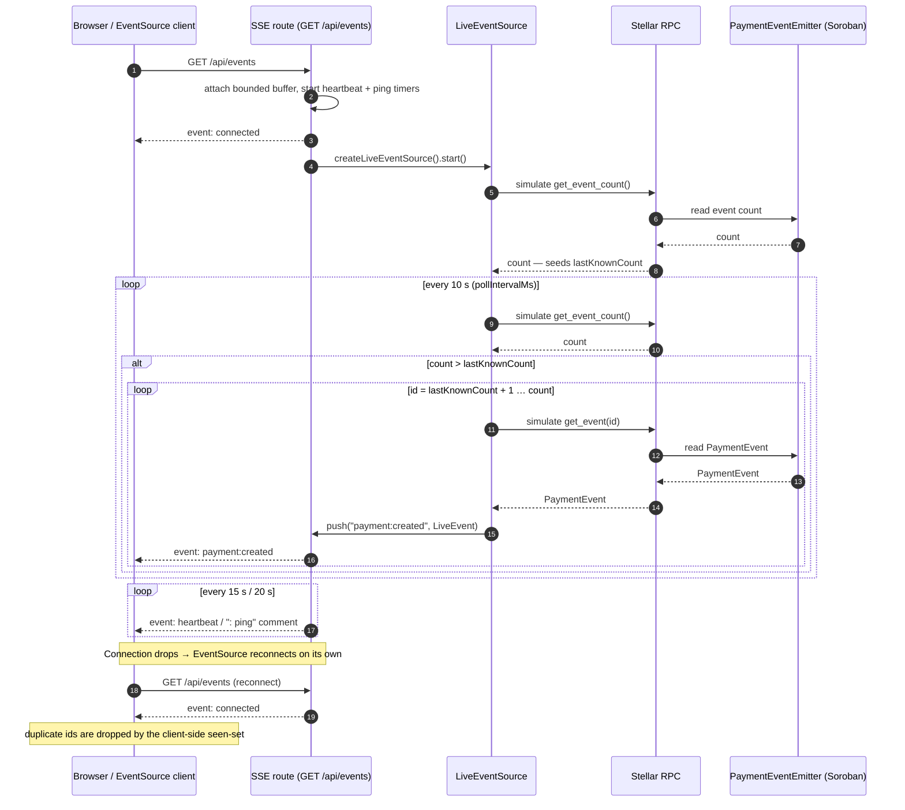

# 📡 OphirPay Live Event Stream (SSE) — Client Integration

> The stream contract for real-time OphirPay payment events. Covers the SSE
> endpoint, every event type with its payload schema, heartbeat/error
> behavior, reconnection semantics, and example client code.

OphirPay streams **live blockchain events** to browsers and integrations via
**Server-Sent Events (SSE)** at `GET /api/events`. The endpoint polls the
deployed `PaymentEventEmitter` Soroban contract and forwards normalized
events. A **WebSocket channel** (`/api/events` on port `8787`, see
[docs/WEBSOCKET.md](WEBSOCKET.md) and [Reconnection & transport](#reconnection--transport)) delivers the _same_
events with lower latency; the official client prefers it and falls back to
SSE automatically.

```
Client ←── SSE: GET /api/events ────polls──→ PaymentEventEmitter (Soroban)
        ←── WS:   ws(s)://host:8787/api/events       │
                                                     ├─ get_event_count()
                                                     └─ get_event(id)
```

## Endpoint

| Property            | Value                                                   |
| ------------------- | ------------------------------------------------------- |
| URL                 | `GET /api/events` (same origin)                         |
| Content-Type        | `text/event-stream`                                     |
| Cache-Control       | `no-cache, no-transform`                                |
| Connection          | `keep-alive`                                            |
| `X-Accel-Buffering` | `no` (disables proxy buffering — required behind Nginx) |
| Auth                | None (public read stream)                               |

**Try it:**

```bash
curl -N https://ophirpay.com/api/events
# → event: connected
#   data: {"message":"SSE stream connected to emitter contract"}
#
# → event: heartbeat
#   data: {"timestamp": 1724000000000}
```

## Architecture flow

The stream is **pull-through-poll**: nothing pushes from Stellar into the
route. The route holds the HTTP connection open, and a shared
`createLiveEventSource` polls the emitter contract every 10 s. Both the SSE
route and the WebSocket server consume that one source, so the two transports
can never disagree about an event.



Read the diagram with these invariants in mind:

- **One poll loop per connection.** The interval is per subscribed client, not
  a shared broadcast; 100 clients means 100 poll loops (see
  [Load testing](#load-testing-issue-391)).
- **The poll is a simulation.** `get_event_count` / `get_event` are read-only
  contract simulations signed by `NEXT_PUBLIC_CHAIN_READ_SOURCE` — nothing is
  submitted, so polling costs no fees.
- **Failures are silent.** A failed simulation is caught and retried on the
  next 10 s cycle; the stream is never closed because RPC blipped.
- **The route owns the connection.** `teardown()` (client abort, stream cancel,
  or slow-consumer disconnect) clears the timers, stops the poll loop, and
  releases the connection gauges exactly once.

## Wire format

Standard SSE framing: `event:` name line, `data:` JSON line, blank line
terminator.

```
event: <name>
data: <json>

```

## Event types & payload schemas

### 1. `connected`

Emitted once when the stream is established.

| Field     | Type     | Description                 |
| --------- | -------- | --------------------------- |
| `message` | `string` | Human-readable confirmation |

```json
{ "message": "SSE stream connected to emitter contract" }
```

### 2. `heartbeat`

Keep-alive ping emitted **every 15 seconds** so proxies and the browser don't
time out an idle stream.

| Field       | Type     | Description                                |
| ----------- | -------- | ------------------------------------------ |
| `timestamp` | `number` | Unix epoch **milliseconds** (`Date.now()`) |

```json
{ "timestamp": 1724000000000 }
```

### 3. `error`

Emitted only when a slow consumer is disconnected (see
[Backpressure & slow consumers](#backpressure--slow-consumers-issue-744)). Clients
should treat it as terminal and reconnect.

| Field     | Type     | Description                             |
| --------- | -------- | --------------------------------------- |
| `code`    | `string` | Always `"SLOW_CONSUMER"`                |
| `reason`  | `string` | `"buffer-overflow"` or `"idle-timeout"` |
| `message` | `string` | Human-readable explanation              |

### 4. `payment:created`

A new payment event detected on-chain. This is the normalized `LiveEvent`
shape — identical across SSE and WebSocket transports.

| Field       | Type     | Description                                                                     |
| ----------- | -------- | ------------------------------------------------------------------------------- |
| `id`        | `number` | Emitter contract event id — **stable dedup key** across reconnects              |
| `event`     | `string` | Always `"payment:created"` for this event                                       |
| `timestamp` | `string` | ISO 8601 UTC (`new Date().toISOString()`) — time of delivery, not on-chain time |
| `paymentId` | `string` | Application payment id, formatted `evt_<id>`                                    |
| `status`    | `string` | Payment status; currently always `"COMPLETED"`                                  |
| `emitter`   | `string` | Emitter label (defaults to `"OphirPay"`)                                        |
| `payer`     | `string` | Payer Stellar address (may be empty)                                            |
| `payee`     | `string` | Payee Stellar address (may be empty)                                            |
| `amount`    | `string` | Payment amount as a decimal string (defaults to `"0"`)                          |
| `txHash`    | `string` | Stellar transaction hash (may be empty)                                         |

```json
{
  "id": 42,
  "event": "payment:created",
  "timestamp": "2026-08-29T09:00:00.000Z",
  "paymentId": "evt_42",
  "status": "COMPLETED",
  "emitter": "OphirPay",
  "payer": "GABCDEFGHIJKLMNOPQRSTUVWXYZ234567",
  "payee": "GBCDEFGHIJKLMNOPQRSTUVWXYZ2345678",
  "amount": "125.50",
  "txHash": "cafebabe..."
}
```

> **Integrator rule:** deduplicate by `id`, not by `txHash` or `paymentId` —
> `id` is the only field guaranteed stable across reconnects.

### Settled payments and batches

Two names show up in design discussions that are **not** SSE frame names. This
is the mapping to what the server actually sends:

| Concept | What `/api/events` emits | Notes |
|---|---|---|
| `payment_confirmed` | `payment:created` with `status: "COMPLETED"` | There is no separate confirmation frame. A payment is only ever streamed once it is recorded on-chain, so every `payment:created` is a confirmed payment. |
| `batch_completed` | N × `payment:created` | `PaymentEventEmitter` stores one `PaymentEvent` per transfer; it has no batch-level event. A batch of 24 recipients produces 24 frames that share a `txHash`. |

The in-app notification pipeline does model batch completion as
`payment.batch_completed` (`src/lib/notifications.ts`), but that is a
notification-centre payload, not part of this stream. **Do not wait for a
`batch_completed` SSE frame** — if you need batch-level UI, correlate
`payment:created` frames by `txHash` and deduplicate by `id`.

The on-chain `PaymentEvent` fields (`version`, `id`, `source`, `payer`,
`payee`, `amount`, `tx_hash`, `timestamp`) are normalized into the `LiveEvent`
shape above: `source` becomes `emitter`, `tx_hash` becomes `txHash`, and
`amount` is serialized as a decimal string. The on-chain `timestamp`
(ledger seconds) is **not** forwarded — the stream's `timestamp` is delivery
time.

### Client protocol event names

The official client listens for exactly these names: `connected`,
`heartbeat`, `payment:created`. Any other SSE frame is ignored.

## Cadence

| Interval       | Value                                                    | Source                     |
| -------------- | -------------------------------------------------------- | -------------------------- |
| Emitter poll   | **10 s** (`pollIntervalMs` default)                      | `createLiveEventSource`    |
| Heartbeat      | **15 s**                                                 | SSE route `setInterval`    |
| WebSocket port | `8787` (`EVENTS_WS_PORT` / `NEXT_PUBLIC_EVENTS_WS_PORT`) | `live-events-ws-server.ts` |

## Reconnection & transport

### SSE (native)

- The browser's `EventSource` **reconnects automatically** on dropped
  connections — no client code needed for the happy path.
- Events are **deduplicated by `id`** (`event-source`/`event-client` keep a
  bounded seen-set of the most recent 1000 ids), so a reconnect never replays
  a duplicate `payment:created` into the UI.
- Poll failures against the emitter contract are **silent**: the next 10 s
  cycle retries.

### WebSocket (preferred) → SSE (fallback)

The official client (`connectLiveEvents`) negotiates transports:

1. **WS first** — connects to `ws(s)://<host>:8787/api/events`.
2. **On failure** (never opened): immediately falls back to SSE.
3. **On drop** after a successful open: reconnects with **exponential backoff**
   (`250ms × 2^attempt`) capped at `maxBackoffMs` (default **10 s**), up to
   `maxReconnectAttempts` (default **3**) attempts, then falls back to SSE.
4. **Malformed frames** (bad JSON) are ignored on both transports.

With the defaults that ladder is short and predictable:

| Event | Delay before the next attempt | Attempt counter |
|---|---|---|
| Initial connect fails | none — straight to SSE | `0` |
| 1st drop after opening | **250 ms** (`250 × 2^0`) | `1` |
| 2nd drop | **500 ms** (`250 × 2^1`) | `2` |
| 3rd drop | **1000 ms** (`250 × 2^2`) | `3` |
| Next drop | none — budget exhausted, switch to SSE | `3 >= maxReconnectAttempts` |

The cap (`maxBackoffMs`, default 10 s) only applies if you raise
`maxReconnectAttempts`; at `250 ms × 2^n` the delay reaches 10 s at attempt 6.
Every delay is reset per connection — a long-lived stream that drops once
always retries after 250 ms first, not after the previous session's delay.

### SSE reconnect specifics

- The route does **not** send an `id:` line or a `retry:` field, so the browser
  uses its own default retry interval (typically ~3 s) and `Last-Event-ID` is
  never populated. Replay protection is the client-side seen-set keyed on the
  payload `id`, not SSE-level resume.
- A reconnect gets a fresh `connected` frame and a fresh poll loop seeded from
  the current `get_event_count()`. Events recorded while the client was away are
  therefore **not replayed** — read them from the emitter contract or the
  payments API if you need the gap filled.
- Backpressure is per connection: if the browser stops reading, the bounded
  buffer sheds the oldest frames instead of growing without bound (see
  [Backpressure & slow consumers](#backpressure--slow-consumers-issue-744)).

### Connection status

The client exposes a status enum — useful for UI indicators:

| Status         | Meaning                                                 |
| -------------- | ------------------------------------------------------- |
| `connecting`   | Transport handshake in progress                         |
| `live`         | Receiving events                                        |
| `reconnecting` | WS dropped; backing off before retry                    |
| `fallback`     | Switched to SSE (WS unavailable/exhausted)              |
| `offline`      | SSE connection error (native reconnection still active) |

## Backpressure & slow consumers (issue #744)

A `ReadableStream` controller queues whatever is `enqueue()`d whether or not
the client reads, so a stalled consumer could otherwise grow server memory
without bound. Both SSE endpoints therefore route every frame through a
**bounded outbound buffer** (`src/lib/events/sse-buffer.ts`):

| Bound                               | Default   |
| ----------------------------------- | --------- |
| Buffered events per connection      | `100`     |
| Buffered bytes per connection       | `256 KiB` |
| Idle timeout (backlog not draining) | `60 s`    |

**Policy — drop-oldest with a marker.** When a new frame would exceed either
ceiling, the oldest buffered frames are dropped and a `: dropped N
slow-consumer event(s)` SSE **comment** is emitted ahead of the next data frame.
Comments are ignored by `EventSource`, so the client protocol is unchanged;
tail the raw stream (`curl -N`) to see the marker. Server-side, each dropped
frame increments `ophirpay_sse_dropped_events_total` on `/api/metrics`.

Separately, a connection whose backlog has not drained within the idle budget
is treated as stalled and closed with the `error` frame (`reason:
"idle-timeout"`). Clients that overflow under the `disconnect` policy (used by
tests) receive `error` with `reason: "buffer-overflow"`.

The WebSocket channel applies the same idea per client: a socket whose outbound
buffer exceeds the byte ceiling is dropped rather than buffered without bound.

Heartbeats still fire every 15 s, and the `ophirpay_sse_open_connections` gauge
is decremented exactly once per connection on teardown, so it returns to its
baseline after disconnects.

## Errors & edge cases

| Situation                        | Behavior                                                                                                                                                         |
| -------------------------------- | ---------------------------------------------------------------------------------------------------------------------------------------------------------------- |
| RPC/emitter down during a poll   | Poll fails silently; retried on the next 10 s cycle                                                                                                              |
| Slow/stalled consumer            | Oldest buffered frames dropped with a marker comment (drop-oldest policy); memory stays bounded. A backlog idle for >60 s is disconnected with an `error` frame. |
| Truncated or non-JSON frame      | Frame ignored (client catches parse errors)                                                                                                                      |
| Event seen twice after reconnect | Dropped — dedup by `id` (window: last 1000 ids)                                                                                                                  |
| WS server not running            | Client falls back to SSE automatically (expected in dev)                                                                                                         |
| Proxy buffers the stream         | Heartbeats pause → clients see a stale feed; set `X-Accel-Buffering: no` (already set) and `proxy_buffering off` in Nginx                                        |

## Example clients

### Browser (JavaScript / TypeScript)

```js
// Subscribe to the SSE stream directly (no dependencies).
const es = new EventSource("/api/events");
const seen = new Set();

function handleEvent(e) {
  try {
    const event = JSON.parse(e.data);
    // Dedup by contract event id — required for reconnects.
    if (typeof event.id === "number" && seen.has(event.id)) return;
    if (typeof event.id === "number") seen.add(event.id);

    switch (e.type) {
      case "connected":
        console.log("Stream connected:", event.message);
        break;
      case "heartbeat":
        // keep-alive — ignore
        break;
      case "payment:created":
        renderPayment(event); // { id, paymentId, payer, payee, amount, txHash, ... }
        break;
    }
  } catch {
    // malformed frame — ignore
  }
}

es.addEventListener("connected", handleEvent);
es.addEventListener("heartbeat", handleEvent);
es.addEventListener("payment:created", handleEvent);
es.onerror = () => console.warn("SSE error — EventSource will reconnect");
```

### Using the official client (React)

```tsx
import { connectLiveEvents } from "@/lib/events/event-client";

useEffect(() => {
  const disconnect = connectLiveEvents({
    onEvent: (event) => {
      if (event.event === "payment:created") {
        setPayments((prev) => [event, ...prev]);
      }
    },
    onStatus: (status, transport) => setStatus({ status, transport }), // "live" | "fallback" | ...
  });
  return disconnect; // cleanup on unmount
}, []);
```

### cURL (debugging)

```bash
curl -N https://ophirpay.com/api/events | \
  while IFS= read -r line; do
    case "$line" in
      "event: payment:created") echo "→ new payment" ;;
    esac
  done
```

## Configuration

| Variable                          | Default         | Purpose                                                 |
| --------------------------------- | --------------- | ------------------------------------------------------- |
| `NEXT_PUBLIC_EVENTS_WS_PORT`      | `8787`          | WebSocket port for the preferred transport              |
| `EVENTS_WS_PORT`                  | `8787`          | Server-side WS listen port (`live-events-ws-server.ts`) |
| `NEXT_PUBLIC_CONTRACT_ID`         | testnet default | Main `OphirPayContract` (for event detail APIs)         |
| `NEXT_PUBLIC_EMITTER_CONTRACT_ID` | testnet default | `PaymentEventEmitter` the stream polls                  |
| `NEXT_PUBLIC_CHAIN_READ_SOURCE`   | —               | Public key used for read-only contract simulations      |

## Load testing (issue #391)

`scripts/sse-load-test.mjs` opens **100 concurrent SSE connections** to
`GET /api/events` and verifies the endpoint holds up under load:

- every client receives the `connected` event;
- every client receives **heartbeats within the expected interval**
  (server interval is 15s; the test asserts the first heartbeat arrives
  within `15s + 10s` tolerance and reports the observed min/max);
- **no connection leak** after clients disconnect — the server's
  `ophirpay_sse_open_connections` gauge (exposed on `/api/metrics`) returns
  to `0` and fresh connections still work afterwards;
- **memory stays bounded** — server heap/RSS deltas sampled from
  `/api/metrics` during the run, and the harness's own heap, must stay under
  generous limits;
- **stalled consumers stay bounded** (issue #744) — a phase opens
  `STALLED_CLIENTS` (default `25`) connections that never read their body,
  asserts server memory stays bounded while they are stalled, then disconnects
  them and asserts the `ophirpay_sse_open_connections` gauge returns to `0`.
  Override with `STALLED_CLIENTS` / `STALLED_DURATION_MS`.

The load test samples `/api/metrics` for the leak and memory gauges, so pass
`METRICS_TOKEN` for the target deployment (otherwise those assertions are
skipped because the endpoint returns `401`):

```bash
# Requires a running OphirPay server (dev or production build)
npm run start            # in one terminal (or: npm run dev)
METRICS_TOKEN=$METRICS_TOKEN npm run test:sse:load    # in another

# Customise the run
BASE_URL=https://staging.example.com CONCURRENCY=250 DURATION_MS=20000 \
  npm run test:sse:load
```

The exit code is `0` on success and `1` if any acceptance check fails. It
runs automatically on every PR in CI (shard 1 of the `e2e-tests` job, after
the production build is served).

## Reference implementation

- Route: `src/app/api/events/route.ts`
- Shared event source & types: `src/lib/events/event-source.ts`
- Client with transport fallback: `src/lib/events/event-client.ts`
- WebSocket server: `src/lib/events/live-events-ws-server.ts` (see [docs/WEBSOCKET.md](WEBSOCKET.md))
- Live events page: `src/app/events/page.tsx`

---

<div align="center">

**[← Back to OphirPay README](../README.md)**

</div>
